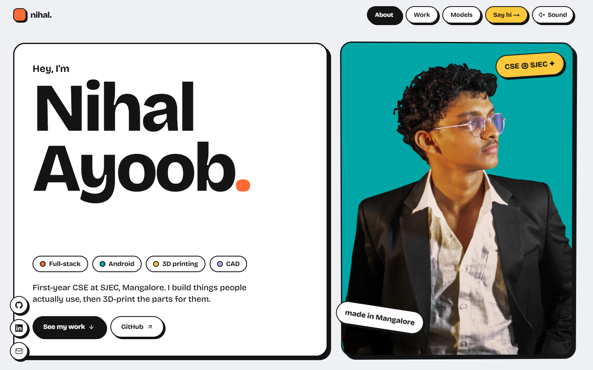

# Nihal Ayoob · Portfolio

### 👉 [**nihalayoob-maker.vercel.app**](https://nihalayoob-maker.vercel.app)

[](https://nihalayoob-maker.vercel.app)

First-year Computer Science student at **SJEC, Mangalore**. I build full-stack web apps, Android and desktop tools, and design parts for 3D printing.

**Contact:** [mnihalayoob@gmail.com](mailto:mnihalayoob@gmail.com) · [LinkedIn](https://www.linkedin.com/in/mohammed-nihal-ayoob-b642453a7) · [GitHub](https://github.com/nihalayoob07)

## Projects on the site

| Project | What it is | Stack | Status |
| --- | --- | --- | --- |
| [ThePrint.Vault](https://theprintvault.in) | Production e-commerce store: catalogue, cart, Razorpay checkout, order tracking, live admin feed | Next.js, TypeScript, SQLite, Razorpay | Live |
| Drill | Android alarm you dismiss by walking, then a 12-week training plan | Kotlin, Android, WebView | Coming to Play |
| Deck | Windows notch with notes, to-dos and drag-to-phone file transfer | Electron, Node.js, KDE Connect | Shipped |
| [PrintLedger](https://github.com/nihalayoob07/printledgerv2) | Pricing calculator and sales ledger for 3D-print shops, one HTML file | TypeScript, React, Vite | Open source |
| [NOVA](https://nova-hackathon-eta.vercel.app) | Hackathon campus platform; I built the Supabase backend and three sections | React, Supabase | Hackathon |
| Invoice Automation | Chrome extension turning WhatsApp order lines into GST e-invoices | Chrome MV3, JavaScript | In daily use |
| Self-hosted infrastructure | The Fedora server behind ThePrint.Vault: Docker, Cloudflare Tunnel, Caddy | Linux, Docker Compose | In production |

The site also shows four of my 3D-printed designs, rendered live in the browser.

## How this site is built

- **Next.js 16** (static export), **TypeScript**, **Tailwind CSS v4**, hosted on **Vercel**
- **GSAP ScrollTrigger + Lenis** for scroll-driven project demos; respects `prefers-reduced-motion`
- **three.js** (React Three Fiber) for the 3D prints, lazy-loaded per panel and lighter on phones
- Node scripts convert Bambu Studio `.3mf` projects to compressed GLBs and record the demo frames with headless Edge

## Run it locally

```bash
npm install
npm run dev
```

Content (projects, timeline, skills) lives in `src/content/`.
